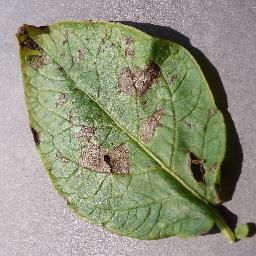
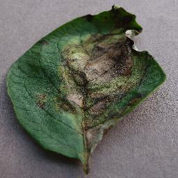

# Potato Leaf Disease Detection Using Deep Learning

## Project Overview

Potato Leaf Disease Detection is a deep-learning image-classification project that uses Convolutional Neural Networks (CNNs) to identify potato leaf conditions from images.

The project focuses on three categories:

- **Potato Early Blight**
- **Potato Late Blight**
- **Potato Healthy**


## Sample Dataset Images

## Sample Dataset Images

| Early Blight | Late Blight | Healthy |
|---|---|---|
|  |  |  |


The main objective is to investigate how deep learning can be applied to agricultural image classification and compare the performance of a custom-built CNN with a pretrained MobileNetV2 model using transfer learning.

An interactive dashboard was also developed using Streamlit to allow users to upload potato leaf images and view model predictions.

## Problem Statement

Potato diseases can negatively affect crop health and agricultural productivity. Identifying visible disease symptoms early can help farmers make more informed crop-management decisions.

Traditional disease identification often involves visually inspecting leaves, which can be challenging when symptoms are difficult to distinguish.

This project explores the use of deep learning and computer vision to classify potato leaf images automatically.

The project is an experimental image-classification prototype and is not intended to replace professional agricultural diagnosis.

## Project Objectives

1. Explore and prepare a labelled potato leaf image dataset.
2. Develop a baseline Convolutional Neural Network.
3. Implement MobileNetV2 using transfer learning.
4. Evaluate both models using classification metrics.
5. Compare model performance on a held-out test dataset.
6. Develop an interactive Streamlit dashboard for image classification and result presentation.

## Technologies and Tools

| Technology | Purpose |
|---|---|
| Python | Main programming language |
| TensorFlow | Deep-learning model development |
| Keras | Neural-network architecture and training |
| NumPy | Numerical operations |
| Pandas | Data processing and analysis |
| Matplotlib | Data visualisation |
| Scikit-learn | Dataset splitting and model evaluation |
| Pillow (PIL) | Image processing |
| Streamlit | Interactive dashboard |
| Jupyter Notebook | Experimentation and documentation |
| VS Code | Development environment |
| Git and GitHub | Version control and project hosting |

## Dataset

The project uses the colour-image portion of the **PlantVillage Dataset**.

**Dataset source:**  
[PlantVillage Dataset – GitHub](https://github.com/spMohanty/PlantVillage-Dataset)

The selected dataset contains three potato leaf categories.

### Dataset Distribution

| Class | Number of Images | Percentage |
|---|---:|---:|
| Potato Early Blight | 1,000 | 46.47% |
| Potato Late Blight | 1,000 | 46.47% |
| Potato Healthy | 152 | 7.06% |
| **Total** | **2,152** | **100%** |

Original image dimensions: **256 × 256 pixels**

The dataset was inspected for image dimensions, class distribution, sample images, and corrupted files. No corrupted images were found during the check.

### Dataset Imbalance

The dataset contains significantly fewer healthy potato leaf images than early-blight and late-blight images.

To address this imbalance during training, class weights were calculated:

| Class | Class Weight |
|---|---:|
| Early Blight | 0.717 |
| Late Blight | 0.717 |
| Healthy | 4.736 |

The higher weight assigned to the healthy class gives errors involving this underrepresented class greater influence during training.

## Project Methodology

The project followed a sequence of data exploration, preprocessing, model development, evaluation, and dashboard implementation.

### 1. Dataset Exploration

The first notebook, `01_dataset_exploration.ipynb`, was used to understand the dataset.

Tasks performed:

- Loaded and inspected the dataset.
- Counted images in each class.
- Visualised class distribution.
- Displayed sample leaf images.
- Checked image dimensions.
- Checked for corrupted images.

Outputs included:

- `dataset/class_distribution.csv`
- `dataset/image_dimensions.csv`

### 2. Dataset Splitting

The dataset was divided into training, validation, and test sets using stratified splitting with `random_state=42`.

| Dataset | Percentage | Images |
|---|---:|---:|
| Training | 70% | 1,506 |
| Validation | 15% | 323 |
| Testing | 15% | 323 |
| **Total** | **100%** | **2,152** |

The training set was used to train the models, the validation set was used to monitor training performance, and the test set was reserved for final evaluation.

The split records were saved as CSV files.

### 3. Image Preprocessing

The third notebook, `03_image_preprocessing.ipynb`, prepared the images for model training.

The preprocessing steps included:

- Resizing images to 224 × 224 pixels.
- Loading images in batches.
- Normalising pixel values for the baseline CNN.
- Applying image augmentation operations.
- Preparing datasets for efficient loading.

Image augmentation included:

- Random horizontal flipping.
- Random rotation.
- Random zoom.

For MobileNetV2, the model-specific `preprocess_input` function was used.

## Model Development

Two deep-learning models were developed and evaluated.

### Model 1: Baseline Convolutional Neural Network

The baseline CNN was built using TensorFlow and Keras.

Its architecture included:

- Input layer accepting images of shape 224 × 224 × 3.
- Data augmentation layers.
- Three convolutional layers with 32, 64, and 128 filters.
- Max-pooling layers.
- Global average pooling.
- Dense layer with 64 units and ReLU activation.
- Dropout layer with a rate of 0.3.
- Output layer with three neurons and softmax activation.

The model contained **101,699 trainable parameters**.

Training configuration:

- Optimiser: Adam
- Learning rate: 0.001
- Loss function: Sparse categorical cross-entropy
- Evaluation metric: Accuracy
- Class weights: Applied
- Early stopping: Applied
- Model checkpointing: Applied

The trained model was saved as:

`models/cnn_baseline.keras`

### Model 2: MobileNetV2 Using Transfer Learning

MobileNetV2 is a pretrained convolutional neural network originally trained on ImageNet.

Transfer learning was used to apply the visual features learned by the pretrained model to the potato leaf classification task.

Implementation steps:

1. Loaded MobileNetV2 with ImageNet pretrained weights.
2. Set `include_top=False` to remove the original classification head.
3. Froze the pretrained base model.
4. Added a global average pooling layer.
5. Added a dropout layer with a rate of 0.3.
6. Added a dense output layer with three softmax units.

Training configuration:

- Optimiser: Adam
- Learning rate: 0.001
- Loss function: Sparse categorical cross-entropy
- Evaluation metric: Accuracy
- Class weights: Applied
- Early stopping: Applied
- Model checkpointing: Applied

The MobileNetV2-specific image preprocessing function was used before training and prediction.

The trained model was saved as:

`models/mobilenetv2.keras`

## Model Evaluation and Results

Both models were evaluated using the same test dataset containing 323 images.

The following evaluation metrics were used:

- Accuracy
- Precision
- Recall
- F1-score
- Confusion matrix
- Test loss

### Model Performance Comparison

| Evaluation Metric | Baseline CNN | MobileNetV2 |
|---|---:|---:|
| Test Accuracy | 82.35% | 96.90% |
| Test Loss | 0.368500 | 0.089542 |
| Macro F1-score | 0.806400 | 0.952047 |
| Weighted F1-score | 0.818500 | 0.968937 |

### Classification Report: MobileNetV2

| Class | Precision | Recall | F1-score |
|---|---:|---:|---:|
| Early Blight | 0.9932 | 0.9667 | 0.9797 |
| Late Blight | 0.9487 | 0.9867 | 0.9673 |
| Healthy | 0.9524 | 0.8696 | 0.9091 |

### Key Findings

MobileNetV2 achieved a test accuracy of 96.90%, compared with 82.35% for the baseline CNN.

This represents an improvement of approximately **14.55 percentage points**.

MobileNetV2 also achieved a lower test loss and higher macro and weighted F1-scores.

Based on these results, MobileNetV2 performed better overall on the selected PlantVillage test dataset.

## Interactive Streamlit Dashboard

A Streamlit dashboard was developed to make the model accessible through a graphical interface.

The dashboard contains four main sections:

### 1. About Project

Provides an introduction to the project, its objectives, and its agricultural application.

### 2. Dashboard

Displays project information and selected model performance summaries.

### 3. Disease Detection

Allows users to upload a potato leaf image and obtain a classification prediction from the selected trained model.

### 4. Model Performance

Presents model evaluation results and performance comparisons.

The dashboard uses TensorFlow to load the trained models and process predictions.

## Project Structure

```text
Potato_Leaf_Disease_Project/
│
├── dashboard/
│   └── app.py
│
├── dataset/
│   ├── processed/
│   │   ├── train/
│   │   ├── validation/
│   │   └── test/
│   │
│   ├── class_distribution.csv
│   ├── image_dimensions.csv
│   ├── train_split.csv
│   ├── validation_split.csv
│   ├── test_split.csv
│   ├── mobilenetv2_results.csv
│   ├── mobilenetv2_classification_report.csv
│   ├── model_comparison.csv
│   └── model_accuracy_comparison.png
│
├── models/
│   ├── cnn_baseline.keras
│   └── mobilenetv2.keras
│
├── notebooks/
│   ├── 01_dataset_exploration.ipynb
│   ├── 02_data_preprocessing.ipynb
│   ├── 03_image_preprocessing.ipynb
│   ├── 04_cnn_baseline.ipynb
│   └── 05_mobilenetv2.ipynb
│
├── plantvillage/
│   └── Original PlantVillage dataset repository
│
├── .gitignore
└── README.md
```

The dataset and processed image directories may be excluded from Git to avoid committing large files.

## Installation and Setup

### Prerequisites

Install the following:

- Python 3.12.7
- Visual Studio Code (or another Python development environment)
- Git

### 1. Clone the Project Repository

```bash
git clone https://github.com/sangvivy/potato-leaf-disease-detection.git
```

Navigate into the project directory:

```bash
cd potato-leaf-disease-detection
```

### 2. Create a Virtual Environment

```bash
python -m venv .venv
```

Activate the environment on Windows PowerShell:

```powershell
.\.venv\Scripts\Activate.ps1
```

### 3. Install Dependencies

Install the required packages:

```bash
pip install tensorflow streamlit numpy pandas matplotlib scikit-learn pillow jupyter ipykernel
```

### 4. Prepare Project Files

Ensure the following files are available in their respective directories:

- `models/cnn_baseline.keras`
- `models/mobilenetv2.keras`
- Required dashboard files.
- Dataset files if you intend to reproduce the training and evaluation experiments.

The original PlantVillage dataset can be obtained from the repository linked in the Dataset section.

### 5. Run the Streamlit Dashboard

From the project root directory, run:

```bash
streamlit run dashboard/app.py
```

Streamlit will start the application and provide a local address in the terminal, usually:

```text
http://localhost:8501
```

Open the displayed local address in your browser to interact with the dashboard.

## Limitations

Although MobileNetV2 achieved high test accuracy, several limitations should be considered:

1. **Dataset imbalance:** The healthy class contains considerably fewer images than the disease classes.
2. **Controlled image conditions:** PlantVillage images were collected under controlled conditions and may not fully represent images captured in real agricultural environments.
3. **Limited class coverage:** The model only classifies the three selected categories.
4. **Generalisation:** High test accuracy does not guarantee the same performance on new images captured in real farms.
5. **Computational resources:** Model development and training were performed using the available local computing resources.

The application should therefore be considered an experimental image-classification prototype rather than a field-validated agricultural diagnostic system.

## Future Improvements

Potential improvements include:

- Collecting additional potato leaf images from real agricultural environments.
- Increasing the number of healthy leaf images to improve class balance.
- Testing the models on independently collected farm images.
- Exploring fine-tuning of pretrained MobileNetV2 layers.
- Comparing additional CNN architectures.
- Improving the dashboard with additional prediction information and visual explanations.
- Evaluating model performance under different lighting and image conditions.

## Conclusion

This project demonstrates the application of deep learning to potato leaf image classification.

Two models were developed: a baseline CNN and MobileNetV2 using transfer learning. Both were evaluated using a held-out test dataset, with MobileNetV2 achieving the stronger overall performance at 96.90% test accuracy.

The project also includes an interactive Streamlit dashboard that allows users to upload images and view predictions.

The results demonstrate the potential of deep learning for agricultural image-classification tasks while highlighting the importance of dataset quality, class balance, and testing under real-world conditions.

## Author

**GitHub:** [sangvivy](https://github.com/sangvivy)

**Project Repository:** [Potato Leaf Disease Detection Using Deep Learning](https://github.com/sangvivy/potato-leaf-disease-detection)
